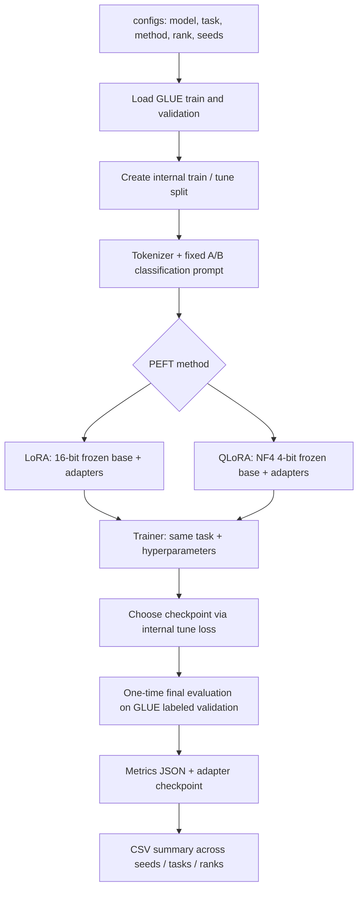

# Compute-Aware PEFT Benchmark: LoRA vs QLoRA

Research starter kit for **A Compute-Aware Decision Framework for Parameter-Efficient Fine-Tuning in LLMs**.

This project performs a controlled comparison of **LoRA** (16-bit pretrained model) and **QLoRA** (4-bit NF4 pretrained model + LoRA adapters). It evaluates GLUE classification tasks using one label-token objective, and records GPU and model-quality metrics. It is **real training code**, not simulated benchmark results.

> **Validation status:** Source code and offline tests can be checked without an NVIDIA GPU. No Llama/Gemma weights or GLUE data are distributed here. A real fine-tuning run needs access to Hugging Face and a CUDA GPU, and has NOT been performed in the environment used to generate this project.

## Architecture



## Directory layout

```text
configs/
  pilot.yaml           # 256-sample Gemma 2 2B IT smoke/pilot, one epoch
  main.yaml            # Llama 3.2 3B Instruct full study
  secondary.yaml       # Gemma 2 2B IT cross-model validation
peft_bench/
  tasks.py             # SST-2/MRPC/QNLI task specs and A/B label mapping
  data.py              # leakage-safe split, tokenize, label masking, collator
  modeling.py          # build identical LoRA adapters; add NF4 for QLoRA
  evaluation.py        # next-token A/B classification + accuracy/F1
  run.py               # one measured fine-tuning run
  matrix.py            # sequential, repeatable grid of experiments
  summarize.py         # aggregate mean/std over random seeds
  environment.py       # GPU / PyTorch / Hugging Face auth checks
  utils.py             # configuration and output files
tests/
  test_tasks.py
  test_label_metrics.py
  test_collator.py
```

## 1. Prerequisites

- Linux (Ubuntu 22.04/24.04 is suitable), Python 3.10 or 3.11, NVIDIA driver and CUDA-compatible PyTorch.
- For a 3B comparison start with **~24 GB VRAM (A10G-class)** if available, then perform a small pilot. A smaller GPU may work for QLoRA but there is no universal memory guarantee.
- Network connection to download models/datasets, enough local disk for model cache and adapter checkpoints.
- Accept the applicable license conditions for the gated models:
  - https://huggingface.co/meta-llama/Llama-3.2-3B-Instruct
  - https://huggingface.co/google/gemma-2-2b-it
- This code runs **one CUDA GPU per process**; it is not a distributed multi-GPU harness.

Use an isolated GPU while measuring VRAM and time.

## 2. Install

```bash
# Ubuntu: from the project root
python3 -m venv .venv
source .venv/bin/activate
python -m pip install --upgrade pip

# On GPU servers, install a PyTorch wheel supported by your driver/CUDA
# using https://pytorch.org/get-started/locally/ before requirements.txt,
# if your environment's default PyTorch installer is not CUDA-enabled.
python -m pip install -r requirements.txt

nvidia-smi
hf auth login
python -m peft_bench.environment
pytest -q
```

Use your own Hugging Face access token. **Do not place tokens or AWS keys in YAML, source code, or a public Git repository.**

If you get `403 / gated repo`, accept the model's terms on its Hugging Face webpage and authenticate with the same account.

## 3. First experiment: Gemma 2 2B IT, SST-2, rank 16

The following commands download the model/data and fine-tune a *real* adapter.

```bash
# LoRA: 16-bit pretrained weights
python -m peft_bench.run \
  --config configs/pilot.yaml --task sst2 --method lora --rank 16 --seed 42

# QLoRA: NF4 4-bit quantized pretrained weights
python -m peft_bench.run \
  --config configs/pilot.yaml --task sst2 --method qlora --rank 16 --seed 42
```

**Pilot is intentionally small**: one epoch, at most 256 training examples and 64 examples per evaluation subset. Pilot performance is *not a meaningful full benchmark*; use it only to prove the training/evaluation/memory logging pipeline works.

Each run creates a folder under `runs/`:

```text
runs/Gemma..._sst2_lora_r16_s42/
  config_resolved.json
  metrics.json                 # actual measured metrics or failure reason
  trainer_log_history.json
  checkpoints/                # training checkpoint selected via tune loss
  adapter/                    # final PEFT weights and tokenizer, NOT base weights
```

After both finish, compare their `metrics.json` fields:

- `final_accuracy`, `final_macro_f1`: model-quality outcomes on the final local set.
- `peak_cuda_allocated_gib`, `peak_cuda_reserved_gib`: GPU tensor allocation/reservation, **not** total device memory from NVIDIA-SMI.
- `training_wall_time_s`: time spent in train(), including periodic tuning/selection/checkpoints.
- `estimated_end_to_end_tokens_per_sec`: approximate processed input+answer tokens / training time (includes eval/save).
- `trainable_parameters`, `adapter_checkpoint_mib`: trainable capacity and saved adapter footprint.
- `status`: `completed`, `oom`, or `failed`.

## 4. Main LoRA / QLoRA experiments: Llama 3.2 3B Instruct

After both pilot methods complete successfully:

```bash
# Very first main pair, SAME model/rank/task/seed:
python -m peft_bench.run --config configs/main.yaml --task sst2 --method lora  --rank 16 --seed 42
python -m peft_bench.run --config configs/main.yaml --task sst2 --method qlora --rank 16 --seed 42

# View the commands for a full 72-run matrix without spending GPU time:
python -m peft_bench.matrix --config configs/main.yaml

# Reduce scope to a 4-run comparison before the full study:
python -m peft_bench.matrix --config configs/main.yaml \
  --tasks sst2 --methods lora qlora --ranks 8 16 --seeds 42 --execute

# FULL study: 2 methods x 4 ranks x 3 tasks x 3 seeds = 72 runs
# WARNING: can incur substantial GPU cost. Runs strictly sequentially.
python -m peft_bench.matrix --config configs/main.yaml --execute
```

To include a real hourly compute price, pass `--usd-per-hour VALUE` to a run or matrix. The code leaves cost blank when no price is supplied. Cost is **training-wall-time-only** (does not include instance idle time, model downloads, storage, taxes or network charges).

To extend across a second model architecture, repeat selected main tasks/ranks with `--config configs/secondary.yaml`.

## 5. Summarize the results

```bash
python -m peft_bench.summarize --runs runs --out results
```

Generates:

- `results/all_runs.csv`: each completed, failed or OOM attempt.
- `results/summary_by_configuration.csv`: mean, standard deviation and sample count for each (model, task, method, rank).

Recommended primary metrics:

| Task | Primary | Secondary |
| --- | --- | --- |
| SST-2 | Accuracy | Macro-F1 |
| MRPC | Accuracy and paraphrase-class F1 | Macro-F1 |
| QNLI | Accuracy | Macro-F1 |

Efficiency: peak CUDA allocated/reserved GiB, train duration, estimated throughput, trainable parameter count, saved adapter MiB, OOM/failed status, and compute-only cost if an hourly rate is provided. **Correlation is not relevant** to these three binary classification tasks; GLUE STS-B would require Pearson/Spearman correlation and a different regression head/objective (not implemented).

## 6. Why A/B labels, rather than generating the English class name?

Both model families are *causal language models*. All three GLUE tasks are treated as binary classification with a deterministic instruction prompt. The correct dataset target is mapped to exactly one answer token, `A` or `B`. Training loss is computed only for the next answer token; prompts are masked with `-100`. Evaluation reads only the scores of the two allowed answer token IDs, so output parsing never fails due to alternate free-form wording.

We **check** that A and B are each one tokenizer token; if not, training aborts instead of silently changing the objective. There are no extra examples in the prompt. The prompt, label codes and dataset splits are unchanged between LoRA and QLoRA within one base model.

For QNLI, the GLUE dataset defines `label 0 = entailment`, `label 1 = not_entailment`: A corresponds to yes, B to no. For MRPC, `label 1` means equivalent/paraphrase. For SST-2, `label 1` means positive.

## 7. Fair-comparison and publication checklist

1. **Same checkpoint:** do not compare Gemma-LoRA with Llama-QLoRA as a method effect.
2. **Same splits:** split official GLUE training set into internal train + tune with fixed seed `2026`; official labeled validation is reserved for one final local evaluation per selected checkpoint. Official GLUE test labels are hidden and are NOT used.
3. **Same protocol:** identical task prompts, target-module selection (`all-linear`), rank, alpha/rank ratio, batch size, optimizer, 3-epoch cap, learning rate and maximum length for the first paired comparison. Then do separate tuning studies as needed.
4. **Same hardware:** log GPU type and memory; don't run unrelated GPU jobs simultaneously.
5. **Same compute budget:** 3 epochs with the same training examples (or define a fixed token budget for another study). Report actual optimizer steps, input lengths/truncation counts, and training wall-clock time.
6. **Check three seeds:** 42 / 123 / 456; report mean and standard deviation. Distinguish tiny improvements from seed-to-seed variance.
7. **Freeze model and dataset revisions:** `revision: main` is for first setup. Replace each with exact Hugging Face commit hashes after initial verification, and store dependency versions, raw dataset fingerprints, seed, chosen checkpoints and GPU model.
8. **Report failures:** an OOM is a resource-feasibility result, not a data point to discard without explanation. Retrying with changed batch size is a new configuration.
9. **Avoid benchmark leakage:** do not select rank/LR/checkpoint based on the final reported evaluation set; use internal tune only.
10. **Classical baseline:** additional full fine-tuning is optional on hardware that supports it, but your first comparison is LoRA vs QLoRA.

### Important scope and limitations

- This is a controlled **LoRA vs QLoRA** comparison, not yet the complete decision recommender, Prefix Tuning or Prompt Tuning described in the initial proposal.
- Both methods use the same adapter parameters at the same rank; quantization primarily changes frozen base-weight storage. Actual VRAM saving is **not** guaranteed to equal 75% of total training memory.
- This code uses one-token classification and an instruction-tuned causal LM. Its results are **not directly equivalent** to GLUE results using a dedicated sequence-classification head or a different prompt.
- Rank changes trainable parameter count; higher rank does not necessarily improve accuracy.
- Memory measurement via `torch.cuda.max_memory_allocated/reserved` covers PyTorch-managed allocations, not all driver allocations or other processes; use `nvidia-smi` or NVML sampling if you also require device-wide utilization/peak.
- `trainable_parameters` is an exact count of trainable adapter weights, but a QLoRA frozen parameter tensor may be physically packed, so this kit intentionally does not report a misleading trainable percentage based on packed `.numel()`.
- If the split's `truncated_count` is substantial, increase sequence length and rerun **both** methods under the same settings.
- Do not report outcomes until genuine experiments have run. Files in this repository contain **no invented accuracy, memory, or cost results**.

## Official references

- [Hugging Face PEFT quantization guide](https://huggingface.co/docs/peft/developer_guides/quantization)
- [Transformers Trainer documentation](https://huggingface.co/docs/transformers/main_classes/trainer)
- [GLUE benchmark dataset](https://huggingface.co/datasets/nyu-mll/glue)
- [Llama 3.2 3B Instruct model](https://huggingface.co/meta-llama/Llama-3.2-3B-Instruct)
- [Gemma 2 2B IT model](https://huggingface.co/google/gemma-2-2b-it)
